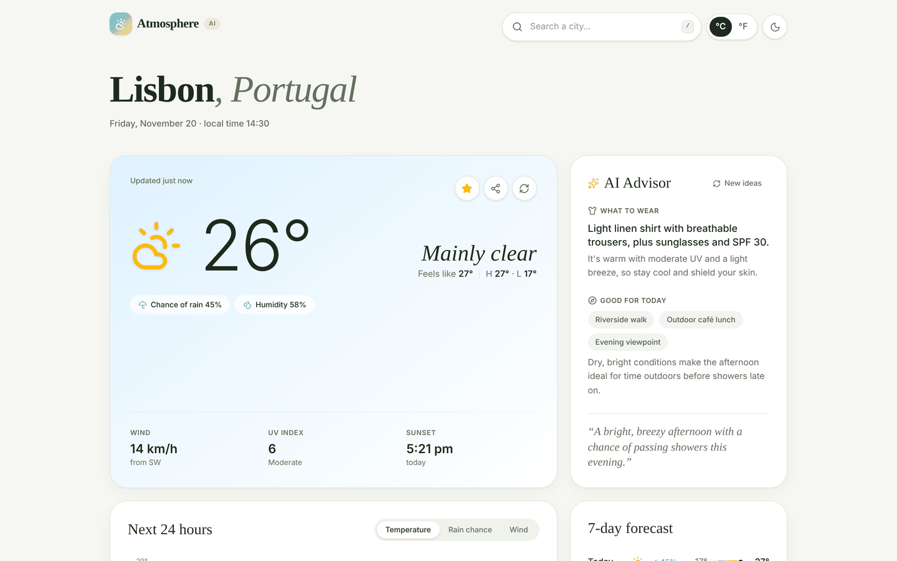
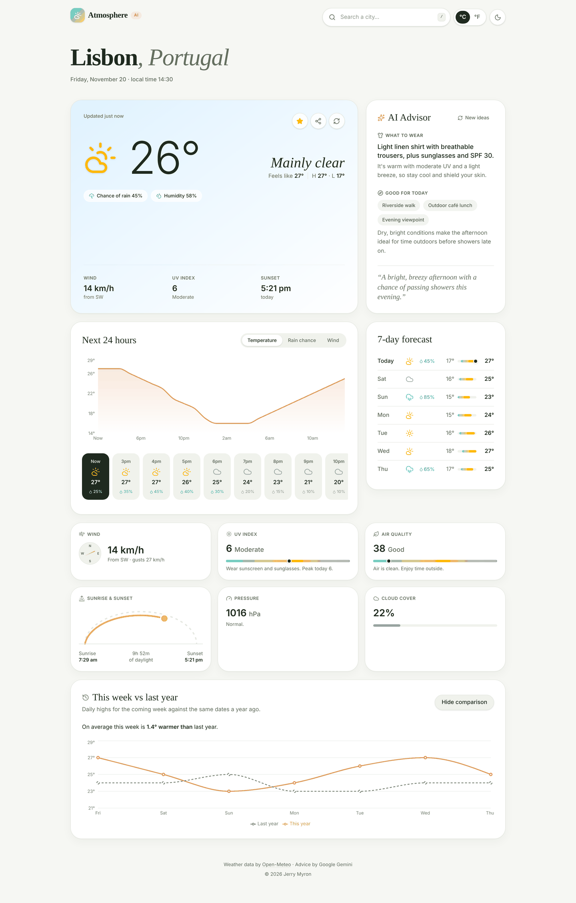
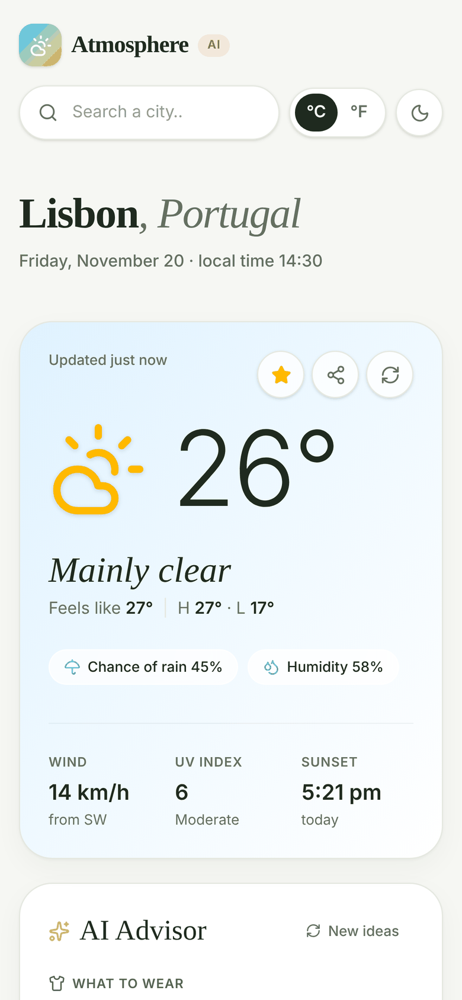
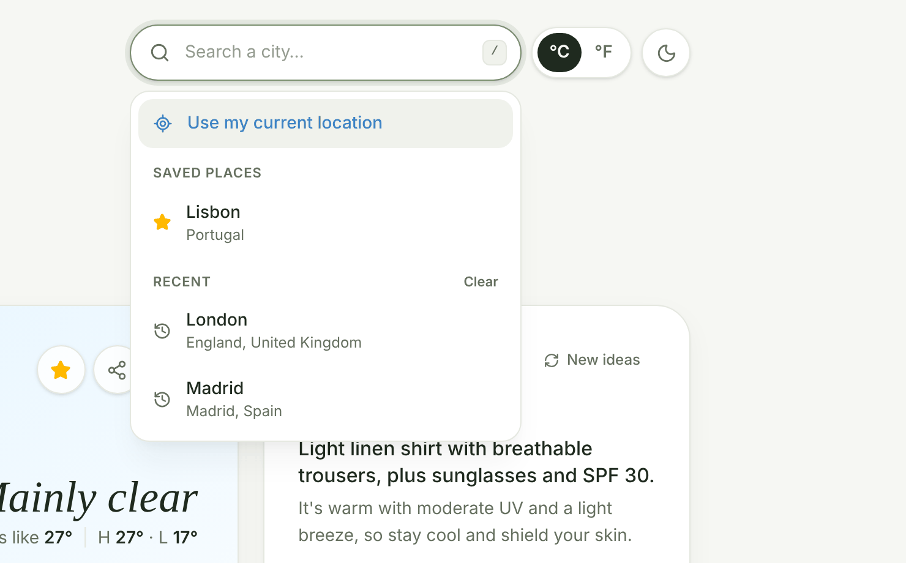
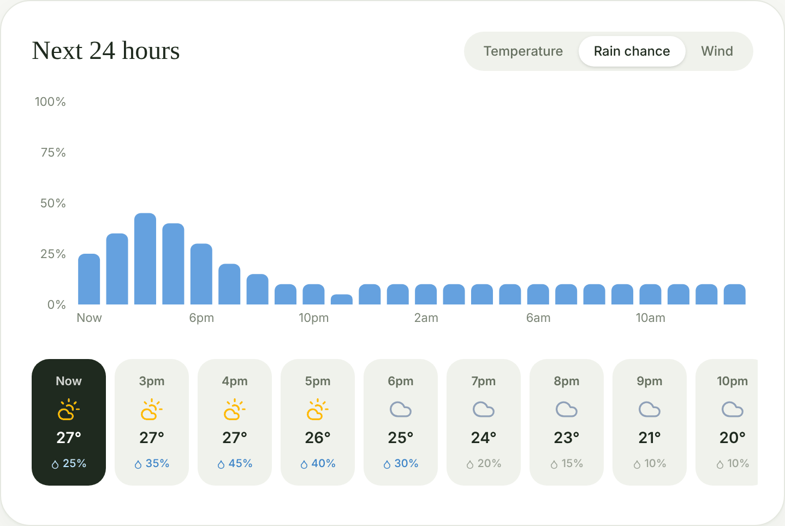
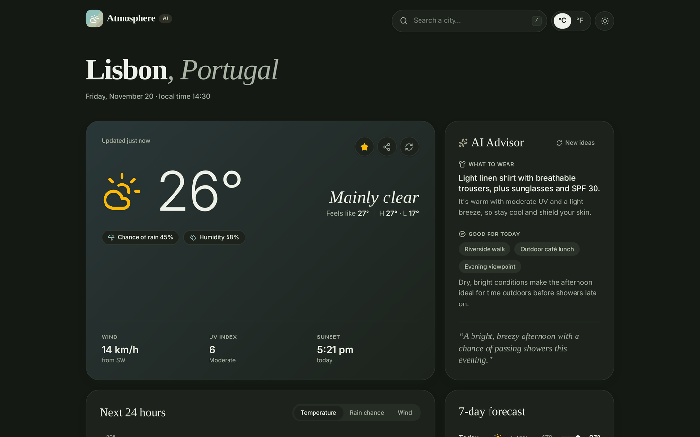

# Atmosphere AI

**Atmosphere AI** is a clean, light weather app that pairs live forecasts with AI advice on what to wear and what to do. It covers the next 24 hours, the coming week, air quality, UV, wind and daylight, and compares this week with the same dates last year.

**Live demo:** [jerrykaz.github.io/atmosphere-ai](https://jerrykaz.github.io/atmosphere-ai)



## Screenshots

<table>
  <tr>
    <td width="66%"></td>
    <td width="34%"></td>
  </tr>
  <tr>
    <td colspan="2" align="center"><sub>Full dashboard (left) and mobile (right)</sub></td>
  </tr>
</table>

<table>
  <tr>
    <td></td>
    <td></td>
  </tr>
  <tr>
    <td align="center"><sub>Search: use my location, saved places, recent</sub></td>
    <td align="center"><sub>Next 24 hours: temperature, rain chance or wind</sub></td>
  </tr>
  <tr>
    <td colspan="2"></td>
  </tr>
  <tr>
    <td colspan="2" align="center"><sub>Optional dark theme</sub></td>
  </tr>
</table>

## Features

**Forecast**
- Current conditions with real "feels like", today's high and low, and live rain chance for the next few hours
- Next 24 hours, starting from the current hour, as a chart you can switch between temperature, rain chance and wind
- 7-day forecast with temperature range bars and a marker for the current temperature
- Air quality (US AQI) with plain-language advice
- UV index with today's peak, wind with compass and gusts, pressure, cloud cover
- Sunrise and sunset arc showing where the sun is now and total daylight
- **This week vs last year**: daily highs compared with the same dates one year earlier

**AI Advisor** (Google Gemini)
- What to wear, with the reason
- 2–3 activity ideas that suit the conditions
- Safety notes only when there is a real concern (high UV, strong wind, storms)
- "New ideas" button to regenerate; similar conditions reuse a cached answer for 30 minutes to save quota
- If AI is unavailable, the card says so instead of showing made-up advice

**Usability**
- Live search with suggestions as you type, typo-tolerant ranking (Fuse.js), full keyboard support, and `/` to focus search from anywhere
- "Use my current location", saved places (star a city) and recent searches
- °C / °F toggle, remembered between visits
- Light theme by default, with an optional dark theme and no flash on load
- Shareable links: the URL holds the city, so a shared link opens the same place
- Refreshes automatically every 10 minutes and when you come back to the tab
- Shows the last saved forecast per city when offline or when the service is down
- Severe weather banner for thunderstorms, violent showers, heavy snow and freezing rain
- Accessible: labelled controls, keyboard-navigable search, readable contrast, and animations that respect "reduce motion"

## Tech stack

| Area | Tools |
| --- | --- |
| Frontend | React 19, TypeScript (strict) |
| Styling | Tailwind CSS 4 |
| Animation | Motion (`motion/react`) |
| Charts | Recharts |
| AI | Google Gemini (`@google/genai`) |
| Weather data | Open-Meteo forecast, air quality, archive and geocoding APIs |
| Reverse geocoding | OpenStreetMap Nominatim |
| Search ranking | Fuse.js |
| Icons | Lucide React |
| Build and deploy | Vite, GitHub Pages |

## Project structure

```
src/
  App.tsx               page layout, location, theme and unit state
  components/           SearchBox, CurrentConditions, AIAdvisor, HourlyForecast,
                        DailyForecast, Details, LastYear, WeatherIcon, Toast
  hooks/                useWeather (fetch, cache, auto-refresh), useInsights,
                        useLocalStorage, useOnline
  lib/                  weather codes, formatting and units, safe storage
  services/             weatherService (Open-Meteo), geminiService
docs/screenshots/       images used in this README
```

## Getting started

**Requirements:** Node.js 18 or newer. A Gemini API key is optional; the forecast works without it.

```bash
git clone https://github.com/JerryKaz/atmosphere-ai.git
cd atmosphere-ai
npm install
cp .env.example .env    # then add your key
npm run dev             # http://localhost:3000/atmosphere-ai/
```

`.env`:

```env
VITE_GEMINI_API_KEY=your_gemini_api_key_here
```

| Script | What it does |
| --- | --- |
| `npm run dev` | Start the dev server |
| `npm run build` | Production build to `dist/` |
| `npm run preview` | Serve the production build locally |
| `npm run lint` | Type-check with TypeScript |
| `npm run deploy` | Build and publish to GitHub Pages |

## Security note

Any `VITE_` variable is bundled into the browser build, so a Gemini key used this way is visible to anyone who opens DevTools. That is fine for local development. For a public deployment, put the Gemini call behind a small server function (for example a Vercel or Cloudflare function) that holds the key and rate-limits requests, and call that endpoint from `geminiService.ts` instead.

## Credits

Designed and developed by [Jerry Myron](https://github.com/JerryKaz).
Weather data by [Open-Meteo](https://open-meteo.com). Map data © OpenStreetMap contributors.
